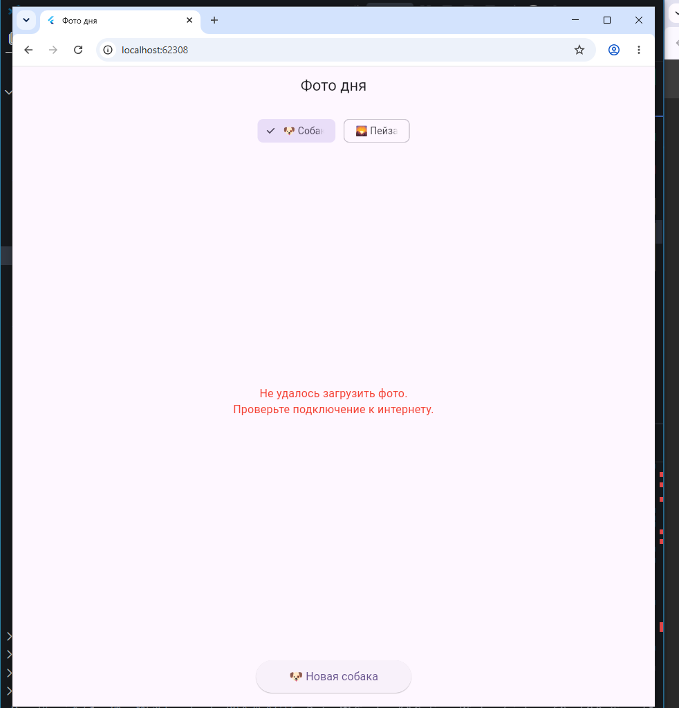

# Photo of the Day

Приложение на Flutter. Изначально приложение загружает фотографии из сети, но в финальной версии переведено на работу с локальными изображениями

## Информация об авторе

*   **Студентка:** Аристова Анастасия Александровна
*   **Группа:** ИСП-241

## Стек и версии

*   **Flutter:** 3.47.3
*   **Dart:** 3.13.3
*   **Платформа:** Web (Chrome)
*   **Пакет:** `http`

## Скриншот приложения




## Как запустить

1. 
   ```bash
   git clone <URL>
   ```
2. 
```bash
cd Flutter_photo_of_the_day
```
3.
```bash
flutter pub get
```
4. 
```bash
flutter run -d chrome
```

## Что изучили
* Понимание того, как работают Future и ключевые слова async/await

* Использование блока try/catch для предотвращения падения приложения при сбоях

* Управление состоянием: Работа с setState в StatefulWidget для переключения между состояниями загрузки, успеха и ошибки

## Ответы на вопросы
1. Что такое Future < T >? Чем отличается от обычного возвращаемого значения?

Future< T > — это объект-обещание, который представляет результат асинхронной операции. Он гарантирует, что значение типа T появится в будущем (или произойдет ошибка). Обычное возвращаемое значение доступно сразу же после вызова функции, а Future позволяет функции не блокировать поток, пока она ожидает результата

2. Что делает await? Блокирует ли он весь поток выполнения?

await приостанавливает выполнение текущей асинхронной функции до тех пор, пока Future не завершится. Он не блокирует весь поток. В это время другие части программы, анимации и интерфейс продолжают работать. Как только результат готов, выполнение функции возобновляется со следующей строки
3. Зачем setState() вызывается дважды в _fetchPhoto()?

Первый вызов нужен для того, чтобы сразу сообщить Flutter: «Началась загрузка, сбрось старые данные и покажи индикатор (_isLoading = true)». Второй вызов происходит уже после завершения await (в блоке finally или в конце метода): он говорит Flutter: «Загрузка завершена, перерисуй экран, чтобы скрыть индикатор и показать картинку (_isLoading = false)»
4. Почему кнопке передаётся _fetchPhoto без скобок, а не _fetchPhoto()?

В свойстве onPressed мы передаем ссылку на функцию, чтобы Flutter вызвал её только в момент нажатия. Если написать _fetchPhoto(), то функция вызовется сразу же при построении экрана, что приведет к непредсказуемому поведению и ошибкам
5. Чем Image.network() отличается от Image.asset()?

Image.network() загружает изображение по указанному URL-адресу из интернета. Image.asset() берет изображение из локальной папки проекта (например, assets/images/), которая была указана в pubspec.yaml 
